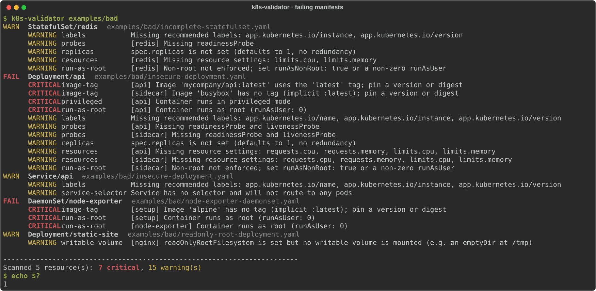
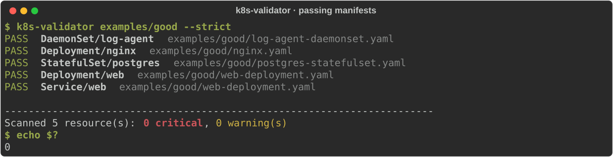
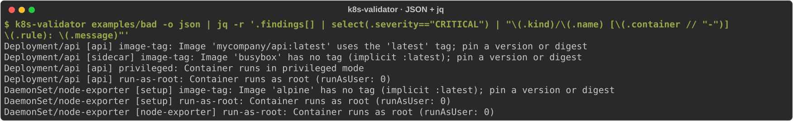

# k8s-deployment-validator

[](https://github.com/Akanksha1809/k8s-deployment-validator/actions/workflows/ci.yml)


**Catch insecure or fragile Kubernetes manifests before they reach a cluster.**

`k8s-validator` is a command-line tool that reads Kubernetes YAML and checks `Deployment`, `StatefulSet`, `DaemonSet` and `Service` resources against security and reliability best practices. It needs no cluster, no kubeconfig and no network access. It reports every problem in a readable form and exits with code `1` when anything critical is found, so a CI pipeline stops the change before it is merged or deployed.



---

## Contents

- [Why](#why)
- [What it checks](#what-it-checks)
- [Quick start](#quick-start)
- [Usage](#usage)
- [Demos](#demos)
- [How it works](#how-it-works)
- [Project layout](#project-layout)
- [Testing](#testing)
- [CI/CD](#cicd)
- [Using it in your own pipeline](#using-it-in-your-own-pipeline)
- [Limitations](#limitations)

---

## Why

Most production incidents caused by manifests are not exotic. They come from a handful of repeated mistakes: an image tagged `latest` that silently changes underneath you, a container that runs as root or in privileged mode, a pod with no memory limit that takes down its node, or a Deployment without probes that receives traffic before it is ready.

All of these are visible in the YAML itself. `k8s-validator` looks for them statically, the moment a manifest changes, which is the cheapest point to fix them.

- **No cluster required:** pure static analysis of files on disk.
- **CI-native:** exit codes are the contract, so any CI system can gate on it.
- **Two output formats:** colored text for people, JSON for tooling.
- **Small and dependency-light:** one runtime dependency (`PyYAML`), under 500 lines of Python.
- **Shipped two ways:** as a Python package and as a non-root Docker image.

---

## What it checks

Every finding is either **CRITICAL** or a **WARNING**.

- **CRITICAL** findings are concrete security or stability risks. Any one of them makes the run fail (exit code `1`).
- **WARNING** findings are best-practice gaps. They are reported but do not fail the run unless you pass `--strict`.

| Rule | Applies to | Severity | Flags when… |
|---|---|---|---|
| `image-tag` | Deployment, StatefulSet, DaemonSet | **CRITICAL** | A container image uses `:latest` or has no tag at all (Kubernetes then pulls `latest`). Digest-pinned images (`image@sha256:…`) pass. |
| `privileged` | Deployment, StatefulSet, DaemonSet | **CRITICAL** | A container sets `securityContext.privileged: true`. |
| `run-as-root` | Deployment, StatefulSet, DaemonSet | **CRITICAL** | A container's effective `runAsUser` is `0`. |
| `run-as-root` | Deployment, StatefulSet, DaemonSet | WARNING | Non-root is not enforced: neither `runAsNonRoot: true` nor any `runAsUser` is set, so the image's default user (often root) is used. |
| `resources` | Deployment, StatefulSet, DaemonSet | WARNING | Any of `requests.cpu`, `requests.memory`, `limits.cpu`, `limits.memory` is missing. All missing fields are listed in one finding. |
| `probes` | Deployment, StatefulSet, DaemonSet | WARNING | A container has no `readinessProbe`, no `livenessProbe`, or neither. |
| `writable-volume` | Deployment, StatefulSet, DaemonSet | WARNING | A container sets `readOnlyRootFilesystem: true` but mounts no writable volume, so software that writes temporary files (nginx, for example) crashes at startup. |
| `replicas` | Deployment, StatefulSet | WARNING | `spec.replicas` is not set, so it defaults to a single replica with no redundancy. |
| `labels` | All four kinds | WARNING | `metadata.labels` lacks any of the [Kubernetes recommended labels](https://kubernetes.io/docs/concepts/overview/working-with-objects/common-labels/) `app.kubernetes.io/name`, `app.kubernetes.io/instance` or `app.kubernetes.io/version`. |
| `service-selector` | Service | WARNING | A Service (other than `type: ExternalName`) has no selector, so it routes to no pods. |

**Container coverage.** The security rules (`image-tag`, `privileged`, `run-as-root`, `writable-volume`) inspect **init containers as well as regular containers**, because an init container runs with the same privileges as the rest of the pod. The operational rules (`resources`, `probes`) inspect regular containers only, since probes do not apply to init containers.

### Exit codes

| Code | Meaning |
|---|---|
| `0` | No critical findings. Warnings are allowed unless `--strict` is set. |
| `1` | At least one critical finding, or any finding at all with `--strict`. |
| `2` | The path does not exist or a YAML file cannot be parsed. |

---

## Quick start

Requires **Python 3.12+**.

```bash
git clone https://github.com/Akanksha1809/k8s-deployment-validator.git
cd k8s-deployment-validator
python3.12 -m venv .venv
source .venv/bin/activate
pip install -e ".[dev]"
```

Try it on the bundled examples:

```bash
k8s-validator examples/bad              # exits 1: critical issues found
k8s-validator examples/good --strict    # exits 0: fully compliant
```

Or run it without installing Python, using Docker:

```bash
docker build -t k8s-deployment-validator .
docker run --rm -v "$PWD/examples/bad:/manifests:ro" k8s-deployment-validator
```

---

## Usage

```
usage: k8s-validator [-h] [-o {text,json}] [--strict] [--no-color] [--version] [path]
```

| Argument | Description |
|---|---|
| `path` | A directory (scanned recursively) or a single YAML file. Defaults to the current directory. |
| `-o, --output {text,json}` | Output format. Default `text`. |
| `--strict` | Treat warnings as failures (exit `1` on any finding). |
| `--no-color` | Disable ANSI colors in text output. |
| `--version` | Print the version and exit. |

```bash
k8s-validator ./k8s                     # scan a directory recursively
k8s-validator deploy.yaml               # scan a single file
k8s-validator ./k8s --strict            # fail on warnings as well
k8s-validator ./k8s -o json             # machine-readable output
python -m k8s_validator ./k8s           # equivalent, without the console script
```

**Colors** are enabled automatically when output goes to a terminal and disabled when it is piped or redirected. Set `NO_COLOR=1` to force them off or `FORCE_COLOR=1` to force them on (useful in CI logs).

### Docker

The image is a multi-stage build on `python:3.12-slim`. It runs as an unprivileged user (UID `10001`), uses `/manifests` as its working directory, and passes any arguments straight to the CLI.

```bash
docker build -t k8s-deployment-validator .

# Scan a directory by mounting it at /manifests (scanned by default)
docker run --rm -v "$PWD/k8s:/manifests:ro" k8s-deployment-validator

# Arguments are forwarded to k8s-validator
docker run --rm -v "$PWD/k8s:/manifests:ro" k8s-deployment-validator --strict -o json
```

---

## Demos

The screenshots below are rendered from real runs of the commands shown, against the manifests in [`examples/`](examples/).

### 1. Failing manifests

[`examples/bad/`](examples/bad/) contains four files that break the rules on purpose:

| File | Resources | What is wrong |
|---|---|---|
| [`insecure-deployment.yaml`](examples/bad/insecure-deployment.yaml) | Deployment + Service | `:latest` image, untagged sidecar image, privileged container, `runAsUser: 0`, no resources, no probes, no replicas, no recommended labels; the Service has no selector |
| [`incomplete-statefulset.yaml`](examples/bad/incomplete-statefulset.yaml) | StatefulSet | Requests but no limits, only a liveness probe, no replicas, partial labels, non-root not enforced |
| [`node-exporter-daemonset.yaml`](examples/bad/node-exporter-daemonset.yaml) | DaemonSet | `runAsUser: 0` at pod level (inherited by every container) and an untagged init-container image |
| [`readonly-root-deployment.yaml`](examples/bad/readonly-root-deployment.yaml) | Deployment | Compliant except for one trap: `readOnlyRootFilesystem: true` with only a read-only ConfigMap mounted, so nginx has nowhere to write and would crash at startup |

```bash
k8s-validator examples/bad
```


Each resource gets a status line (`PASS`, `WARN` or `FAIL`) followed by its findings, critical first. The bracketed name is the container the finding belongs to. The summary shows **7 critical, 15 warnings**, and the exit code is `1`. `Deployment/static-site` shows that a single runtime trap is caught even when everything else is correct.

### 2. Passing manifests

[`examples/good/`](examples/good/) holds the same kinds of workloads written correctly: pinned images, full requests and limits, both probes, non-root security contexts, explicit replicas and recommended labels. The two nginx-based Deployments also run with a read-only root filesystem and an `emptyDir` mounted at `/tmp`.

```bash
k8s-validator examples/good --strict
```



All five resources pass even in `--strict` mode, so the exit code is `0`.

### 3. JSON output for tooling

`-o json` prints a summary and the full list of findings:

```bash
k8s-validator examples/bad -o json
```

```json
{
  "summary": {
    "resources": 5,
    "critical": 7,
    "warnings": 15
  },
  "findings": [
    {
      "rule": "privileged",
      "severity": "CRITICAL",
      "message": "Container runs in privileged mode",
      "kind": "Deployment",
      "name": "api",
      "namespace": "default",
      "file": "examples/bad/insecure-deployment.yaml",
      "container": "api"
    }
  ]
}
```

*(The real output lists all 22 findings; one is shown here.)* `container` is `null` for findings about the whole resource, such as `labels` or `replicas`. Findings are listed resource by resource in rule order; the text report is the one that sorts critical issues first.

Combined with `jq`, it gives you a compact list of critical issues, one per line:

```bash
k8s-validator examples/bad -o json \
  | jq -r '.findings[] | select(.severity=="CRITICAL") | "\(.kind)/\(.name) [\(.container // "-")] \(.rule): \(.message)"'
```



Other useful filters:

```bash
# Count findings per rule
k8s-validator ./k8s -o json | jq '[.findings[].rule] | group_by(.) | map({rule: .[0], count: length})'

# Save a report artifact
k8s-validator ./k8s -o json > validation-report.json
```

---

## How it works

The tool is a short pipeline. Each stage lives in its own module and talks to the next only through three small data types.

```
                 ┌──────────────┐      ┌───────────────┐      ┌──────────────┐
  path  ───────▶ │  loader.py   │ ───▶ │   checks.py   │ ───▶ │ reporter.py  │ ───▶ stdout
                 │ discover and │      │ run the rules │      │ text or JSON │
                 │ parse YAML   │      │ per resource  │      │              │
                 └──────────────┘      └───────────────┘      └──────────────┘
                     Resource[]             Finding[]
                                                                     │
                 cli.py: parses arguments, wires the stages together and maps findings to an exit code
```

### 1. Loading: `loader.py`

- If `path` is a file, only that file is read. If it is a directory, every `*.yaml` and `*.yml` file beneath it is collected recursively and processed in sorted order, so output is deterministic.
- Each file is parsed with `yaml.safe_load_all`, so files containing several `---`-separated documents work, and no arbitrary YAML tags are executed.
- `kind: List` wrappers (as produced by `kubectl get -o yaml`) are flattened into their items.
- Only `Deployment`, `StatefulSet`, `DaemonSet` and `Service` objects are kept. Everything else (ConfigMaps, Ingresses, CRDs, empty documents) is skipped without error.
- Each kept object becomes a `Resource` that records its kind, name, namespace (default `default`), source file and raw body.
- A missing path or malformed YAML raises `ManifestError`, which the CLI reports on stderr with exit code `2`.

### 2. Checking: `checks.py`

Each rule is a plain function that takes one `Resource` and yields zero or more `Finding`s. A registry, `CHECKS`, pairs every function with the set of kinds it applies to, and `validate()` runs each applicable rule against each resource.

```python
CHECKS = [
    (WORKLOAD_KINDS,  check_image_tag),
    (WORKLOAD_KINDS,  check_resources),
    (WORKLOAD_KINDS,  check_privileged),
    (WORKLOAD_KINDS,  check_run_as_root),
    (WORKLOAD_KINDS,  check_probes),
    (WORKLOAD_KINDS,  check_writable_volume),
    (REPLICATED_KINDS, check_replicas),       # Deployment, StatefulSet
    (ALL_KINDS,       check_labels),
    ({"Service"},     check_service_selector),
]
```

Some rules need more than a key lookup to be accurate:

- **Image references are parsed, not pattern-matched.** A digest (`@sha256:…`) counts as pinned. The tag is read from the last path segment only, so a registry port is never mistaken for a tag: `localhost:5000/app` is correctly treated as untagged, and `localhost:5000/app:2.0` as tagged `2.0`.
- **Security context follows Kubernetes precedence.** For `run-as-root`, a container's own `securityContext` overrides the pod-level one, matching how the kubelet resolves `runAsUser` and `runAsNonRoot`. A pod-level `runAsUser: 0` is therefore reported once for every container that inherits it.
- **Writable volumes mean any mount not marked `readOnly: true`.** The `writable-volume` rule only runs for containers that set `readOnlyRootFilesystem: true`.
- **Malformed input degrades safely.** Missing or `null` sections (`spec`, `template`, `containers`, `securityContext` and so on) are treated as empty, so an incomplete manifest produces findings rather than a crash.

### 3. Reporting: `reporter.py`

- **`TextReporter`** groups findings by the exact resource they belong to (so same-named resources in different namespaces never merge) and prints one status line per resource: `PASS` (green), `WARN` (yellow, warnings only) or `FAIL` (red, at least one critical). Findings follow, critical first, then alphabetically by rule, each tagged with its container where relevant. A summary line closes the report.
- **`JsonReporter`** prints a `summary` object and a flat `findings` array, which is easy to filter with `jq` or ingest elsewhere.

### 4. Exit-code policy: `cli.py`

The CLI is the only place that knows about processes and exit codes. It returns `1` if any finding is critical, or if `--strict` is set and there are any findings at all. Otherwise it returns `0`. Keeping this policy out of the rules means every rule can be unit-tested as a pure function.

### Data model: `models.py`

| Type | Purpose |
|---|---|
| `Severity` | `CRITICAL` or `WARNING` |
| `Resource` | One parsed Kubernetes object: kind, name, namespace, source file and raw body |
| `Finding` | One violation: rule ID, severity, message, the resource and (optionally) the container |

### Adding a rule

1. Write a function `check_<name>(resource) -> Iterator[Finding]` in `checks.py`.
2. Add one line to `CHECKS` naming the kinds it applies to.
3. Add positive and negative tests in `tests/test_checks.py`.

No other module needs to change. The reporters and the exit-code policy pick the new rule up automatically.

---

## Project layout

```
k8s-deployment-validator/
├── k8s_validator/
│   ├── __init__.py          # package version
│   ├── __main__.py          # enables `python -m k8s_validator`
│   ├── cli.py               # argument parsing and exit-code policy
│   ├── loader.py            # file discovery and YAML parsing
│   ├── checks.py            # validation rules and the CHECKS registry
│   ├── reporter.py          # text and JSON output
│   └── models.py            # Severity, Resource, Finding
├── tests/
│   ├── conftest.py          # shared fixture: a fully compliant Deployment to mutate
│   ├── test_checks.py       # one or more tests per rule
│   ├── test_loader.py       # discovery and parsing
│   └── test_cli.py          # end-to-end runs against examples/
├── examples/
│   ├── good/                # compliant manifests, pass with --strict
│   └── bad/                 # intentionally broken manifests, exit 1
├── docs/images/             # demo screenshots used in this README
├── .github/workflows/ci.yml # CI pipeline
├── Dockerfile               # multi-stage, non-root runtime image
├── pyproject.toml           # packaging, dependencies, pytest config
└── LICENSE
```

---

## Testing

```bash
pytest -v
```

The suite has **40 tests**:

| File | Tests | Covers |
|---|---|---|
| `test_checks.py` | 29 | Every rule, both when it should fire and when it should not; image reference parsing (untagged, `latest`, registry ports, digests); init-container coverage; container-over-pod security-context precedence; writable-volume detection; kind scoping (no `replicas` check for DaemonSets, no selector check for `ExternalName` Services) |
| `test_loader.py` | 5 | Multi-document files, unsupported kinds skipped, `kind: List` flattening, recursive discovery that ignores non-YAML files, invalid YAML and missing paths |
| `test_cli.py` | 6 | End-to-end runs: `examples/good` passes with `--strict`, `examples/bad` exits `1` and reports image-tag, privileged, run-as-root, resources, probes, replicas, labels and writable-volume findings, warnings-only input exits `0` (or `1` with `--strict`), same-named resources in different namespaces reported separately, JSON structure, exit code `2` for a missing path |

Rule tests start from one fully compliant Deployment fixture and change a single field, so each test isolates exactly one behaviour.

---

## CI/CD

[`.github/workflows/ci.yml`](.github/workflows/ci.yml) runs on **every push and every pull request**, with read-only repository permissions.

```
                ┌──────────────────────┐
                │         test         │
                │  pytest, Python 3.12 │
                └──────────┬───────────┘
              ┌────────────┴────────────┐
   ┌──────────▼───────────┐  ┌──────────▼───────────┐
   │       validate       │  │        docker        │
   │ good --strict → 0    │  │ build the image      │
   │ bad           → 1    │  │ run it on good/      │
   └──────────────────────┘  └──────────────────────┘
```

| Job | Runs after | What it proves |
|---|---|---|
| **test** | – | Installs the package with its dev extras and runs the full pytest suite. |
| **validate** | test | Installs the CLI as a user would and runs it for real. `examples/good` must pass in `--strict` mode, and `examples/bad` must exit with **exactly** `1`. Any other code, including a crash (`2`), fails the job. This checks that the tool still catches what it should, not merely that it runs. |
| **docker** | test | Builds the production image and runs it against `examples/good` with `--strict`, confirming the shipped artifact works end to end. |

`validate` and `docker` run in parallel once `test` has passed. A pull request that breaks a rule, the packaging or the image is caught before merge.

---

## Using it in your own pipeline

**GitHub Actions**, installing from this repository:

```yaml
- uses: actions/setup-python@v5
  with:
    python-version: "3.12"
- run: pip install git+https://github.com/Akanksha1809/k8s-deployment-validator.git
- run: k8s-validator k8s/
```

**Any CI system**, using the Docker image you have built:

```bash
docker run --rm -v "$PWD/k8s:/manifests:ro" k8s-deployment-validator --strict
```

**Helm or Kustomize projects**: render first, then validate the output.

```bash
helm template my-release ./chart --output-dir rendered/
k8s-validator rendered/
```

```bash
kustomize build overlays/prod > rendered.yaml
k8s-validator rendered.yaml
```

---

## Limitations

- **Static only.** It validates what is written in the YAML. It cannot see an image's `USER` directive, admission-controller mutations, or policies enforced inside the cluster.
- **Raw manifests.** Helm templates and Kustomize overlays must be rendered before validation (see above).
- **Fixed policy.** Rules, severities and the list of recommended labels are defined in `checks.py`. There is no configuration file or per-resource suppression, which keeps the tool simple. Change the code to change the policy.
- **Four kinds.** Only Deployments, StatefulSets, DaemonSets and Services are validated. Jobs, CronJobs and bare Pods are skipped.

---

## License

[MIT](LICENSE)
